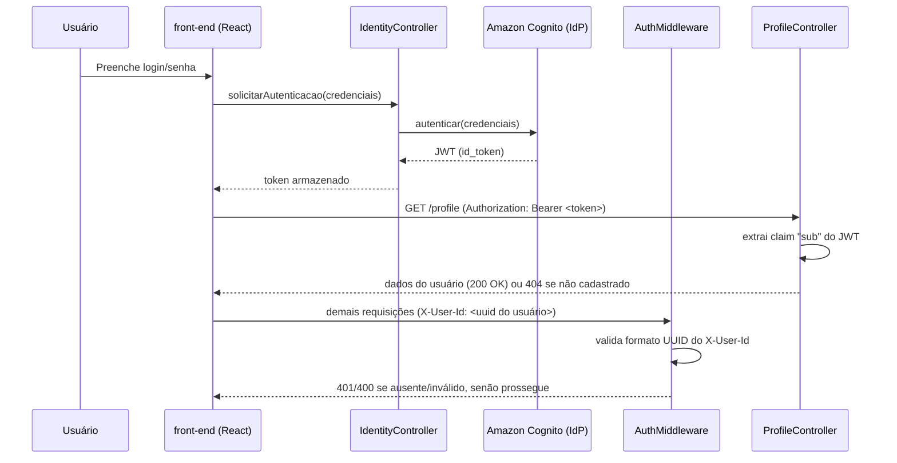
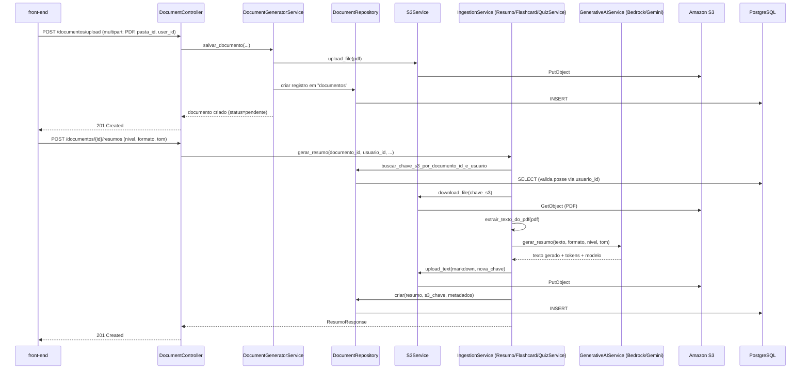
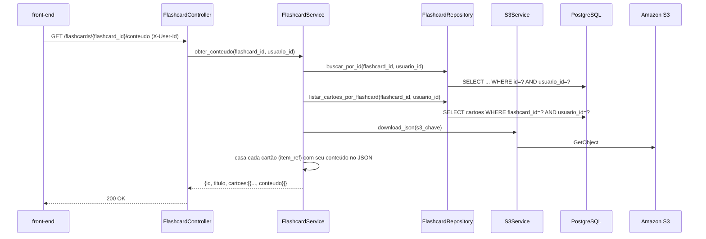
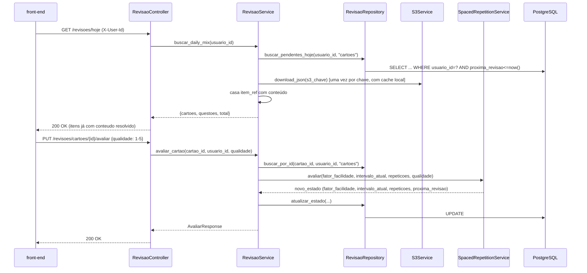

# 4.2 Projeto dos Componentes, 4.5 Diagramas de Interação e 4.7 Segurança e Controle de Acesso

> Documento de apoio à documentação acadêmica (TCC) do projeto Bright EdTech. Descreve, com base na implementação real do backend (`app/`) e no diagrama de componentes do sistema, a estrutura interna dos principais componentes, como eles colaboram em tempo de execução e as decisões de segurança adotadas.

---

## 4.2 Projeto dos Componentes

O sistema segue uma arquitetura em camadas (Controller → Service → Repository), implantada como um monólito modular em contêiner (FastAPI + AWS ECS Fargate), integrado a serviços gerenciados da AWS. O diagrama de componentes do sistema (Nível 3 do modelo C4) organiza a aplicação em quatro grandes agrupamentos: **Client-Side**, **Server - Back-End**, **Fonte de Dados** e **Sistemas Externos**.

### 4.2.1 Client-Side

| Componente | Responsabilidade | Interface |
|---|---|---|
| **front-end (React)** | Single Page Application. Renderiza navegação de pastas/documentos, editor de resumos, flashcards, quizzes e tela de revisão diária (Daily Mix). | Consome a API REST do backend via HTTPS (`fetch`/`axios`); consome o `IdentityController` para obter token de sessão. |
| **IdentityController** | Encapsula o fluxo de autenticação do lado do cliente (login/signup via Amazon Cognito, armazenamento do token JWT). | Comunica-se com o Amazon Cognito (IdP) e expõe o token para o front-end anexar nas chamadas HTTP. |

### 4.2.2 Server - Back-End

O backend é organizado em três sub-camadas: **Controllers** (roteamento HTTP / validação de entrada), **Services** (regras de negócio) e **Repositories** (acesso a dados). Essa separação é a mesma refletida na estrutura de pastas do código-fonte: `app/api/routers/`, `app/services/`, `app/repositories/`.

#### Camada de borda (Middleware)

| Componente | Responsabilidade | Interface |
|---|---|---|
| **AuthMiddleware** | Intercepta requisições destinadas às rotas autenticadas e extrai a identidade do usuário. Na implementação atual, corresponde à dependência `get_current_user_id` (`app/api/dependencies.py`), que lê o cabeçalho `X-User-Id` e o valida como UUID, retornando `401`/`400` em caso de ausência ou formato inválido. | Consumida como `Depends(get_current_user_id)` por todos os controllers que exigem autenticação. |

#### Controllers

| Componente | Responsabilidade | Rotas expostas |
|---|---|---|
| **ProfileController** | CRUD de perfil de usuário, onboarding e leitura de perfil via token Cognito. | `POST/GET/PUT/DELETE /profile`, `POST /profile/{id}/perfil`, `GET /profile/{id}/dashboard` |
| **DocumentController** | Upload, renomeação, exclusão e obtenção de URL de visualização de documentos; ponto de entrada para geração de resumos/flashcards/quizzes vinculados a um documento. | `POST /documentos/upload`, `GET /documentos/{id}/url-visualizacao`, `PUT/DELETE /documentos/{id}`, `POST/GET /documentos/{id}/resumos|flashcards|quizzes` |
| **FlashcardController** | Leitura de conteúdo e exclusão de sets de flashcards. | `GET /flashcards/{id}/conteudo`, `DELETE /flashcards/{id}` |
| **QuizController** | Leitura de conteúdo e exclusão de quizzes. | `GET /quizzes/{id}/conteudo`, `DELETE /quizzes/{id}` |

> Nota de implementação: no código, `DocumentController` corresponde aos routers `documentos_router` e `pastas_router` em `app/api/routers/document.py`; `FlashcardController`/`QuizController` correspondem aos routers `flashcards_router`/`quizzes_router` no mesmo arquivo, e às rotas de revisão em `app/api/routers/revisao.py`.

#### Services

| Componente | Responsabilidade | Colabora com |
|---|---|---|
| **ProfileService** | Regras de negócio de perfil (criação, atualização, onboarding). | `ProfileRepository` |
| **DashboardService** | Agrega visão geral de uso da plataforma (últimos resumos/flashcards/quizzes, totais). | `ProfileRepository`/`DashboardRepository` |
| **DocumentGeneratorService** | Orquestra a criação de pastas, upload de documentos e o disparo da geração de artefatos (resumo, flashcard, quiz) a partir de um PDF. | `DocumentRepository`, `S3Service`, `IngestionService` |
| **GenerativeAIService** | Abstrai a comunicação com o provedor de IA generativa. Na implementação (`BedrockService`), decide entre Amazon Bedrock (Claude) e Google Gemini (fallback), conforme disponibilidade/erro do provedor primário. | Amazon Bedrock (externo), Google Gemini (externo) |
| **IngestionService** | Orquestra a ingestão de conteúdo: extração de texto do PDF (`pdf_utils.extrair_texto_do_pdf`), chamada ao `GenerativeAIService` e persistência do artefato gerado. Na implementação, essa responsabilidade está distribuída entre `ResumoService`, `FlashcardService` e `QuizService`, que seguem o mesmo fluxo (buscar PDF → extrair texto → gerar conteúdo → salvar no S3 → persistir metadados). | `S3Service`, `GenerativeAIService`, `DocumentRepository` |
| **SpacedRepetitionService** | Implementa o algoritmo SM-2 (SuperMemo-2) de repetição espaçada: calcula fator de facilidade, intervalo e próxima data de revisão a partir da nota de qualidade (1–5) informada pelo usuário. | `RevisaoService` (orquestrador que também resolve o conteúdo no S3 e mistura cartões/questões pendentes) |
| **S3Service** | Abstração de toda a lógica de comunicação com o AWS S3 (upload/download de PDFs, resumos em Markdown e flashcards/quizzes em JSON, geração de URLs pré-assinadas). | Amazon S3 (externo) |
| **SecretManagerService** | Abstrai a obtenção de credenciais sensíveis (credenciais do banco de dados, chave de API do provedor de IA de fallback) fora do código-fonte. Na implementação atual, é realizada via **AWS Systems Manager Parameter Store (SSM)** — não via AWS Secrets Manager propriamente dito — com parâmetros do tipo `SecureString` decriptados via KMS. O componente é carregado uma única vez por processo (cache em memória) e possui *fallback* para variáveis de ambiente caso o SSM esteja inacessível. | AWS SSM Parameter Store + KMS (externo) |

#### Repositories

| Componente | Responsabilidade |
|---|---|
| **ProfileRepository** | CRUD da tabela `usuarios`. |
| **DocumentRepository** | CRUD de `pastas` e `documentos`; resolve a chave S3 de um documento validando posse (`documento_id` + `usuario_id`). |
| **FlashcardRepository** | CRUD de `flashcards` (sets) e `cartoes` (itens individuais de SM-2), incluindo listagem por documento e por set. |
| **QuizRepository** | CRUD de `quizzes` e `questoes`, espelhando a estrutura do `FlashcardRepository`. |

Todos os repositórios recebem a conexão de banco (`psycopg2`) por injeção de dependência (`Depends(get_db)`) e **toda consulta que retorna dados de domínio é filtrada por `usuario_id`**, o que é o mecanismo central de controle de acesso a dados (detalhado na seção 4.7.2).

### 4.2.3 Fonte de Dados

| Componente | Responsabilidade |
|---|---|
| **DatabaseServer (RDS/PostgreSQL)** | Armazena exclusivamente metadados estruturados: usuários, árvore de pastas/documentos, metadados de resumos/flashcards/quizzes e o estado do algoritmo SM-2 (`fator_facilidade`, `intervalo_atual`, `repeticoes`, `proxima_revisao`). Conteúdo pesado (texto de resumo, perguntas/respostas) **não** é armazenado aqui — apenas a referência (`s3_chave`) para o objeto correspondente no S3. |

### 4.2.4 Sistemas Externos

| Componente | Papel no sistema |
|---|---|
| **Amazon Cognito (IdP)** | Provedor de identidade: cadastro/login de usuários, emissão de token JWT consumido pelo front-end e, opcionalmente, validado pelo `ProfileController` (`GET /profile`). |
| **Amazon Bedrock** | Provedor principal de IA generativa (modelos Claude) para geração de resumos, flashcards e quizzes a partir do texto extraído do PDF. |
| **S3** | Armazenamento de objetos: PDFs originais, resumos em Markdown e flashcards/quizzes em JSON. |
| **AmazonSecretManager** (representado no diagrama) | Fonte de credenciais sensíveis. Implementado via AWS SSM Parameter Store (ver nota na seção de Services). |

---

## 4.5 Diagramas de Interação

Esta seção descreve, em forma de diagrama de sequência (notação Mermaid) e narrativa textual, os fluxos de interação mais relevantes do sistema.

### 4.5.1 Autenticação e primeira requisição autenticada

**Observação de projeto:** o sistema usa **dois mecanismos de identidade coexistentes**: o JWT do Cognito é usado apenas na primeira busca de perfil (`GET /profile`, para localizar o `usuario_id` a partir do `cognito_id`); a partir daí, o front-end passa a enviar o `X-User-Id` (UUID interno) em todas as demais chamadas. Essa decisão simplifica a validação de identidade nas rotas de domínio, mas concentra a responsabilidade de "não forjar o X-User-Id" inteiramente no cliente — trade-off discutido na seção 4.7.1.

### 4.5.2 Upload de documento e geração de artefato (resumo/flashcard/quiz)

O mesmo padrão de colaboração (buscar PDF → extrair texto → chamar IA → salvar artefato no S3 → persistir metadados no banco) se repete para `FlashcardService` e `QuizService`, mudando apenas o *prompt* enviado ao `GenerativeAIService` e a tabela de destino (`flashcards`+`cartoes` ou `quizzes`+`questoes`).

### 4.5.3 Consulta de conteúdo por documento (Document Hub)

Esse fluxo ilustra o padrão de **enriquecimento de dados**: o banco guarda apenas o estado de repetição espaçada por item (`item_ref`, `fator_facilidade`, `proxima_revisao`), e o conteúdo textual (pergunta/resposta) é resolvido sob demanda a partir do S3 e combinado em memória antes de retornar ao cliente — evitando duplicar conteúdo pesado no banco relacional.

### 4.5.4 Revisão diária (Daily Mix / algoritmo SM-2)

---

## 4.7 Segurança e Controle de Acesso

### 4.7.1 Autenticação

O sistema adota um modelo de autenticação em duas camadas, complementares:

1. **Amazon Cognito como Identity Provider (IdP):** responsável pelo cadastro e login de usuários, aplicando as políticas de senha e emitindo tokens JWT no padrão OAuth2/OIDC.
2. **Validação do token em toda requisição à API:** um componente central de autenticação (posicionado na borda do backend, antes de qualquer rota de negócio) valida a assinatura, o emissor e a expiração do token JWT recebido no cabeçalho `Authorization: Bearer <token>`. Requisições sem token, com token expirado ou com assinatura inválida são recusadas imediatamente, sem chegar à lógica da aplicação.

Além da validação do token, as rotas de domínio (documentos, resumos, flashcards, quizzes, revisões) usam o identificador do usuário (UUID interno) para saber de quem são os dados solicitados — esse identificador é conferido junto ao token em cada requisição, de forma que as duas informações precisam ser consistentes entre si.

### 4.7.2 Autorização e controle de acesso a dados

A autorização segue o princípio de **isolamento por usuário em toda consulta de domínio**: cada operação de leitura, atualização ou remoção de um recurso (documento, resumo, flashcard, quiz, cartão de revisão, questão) é sempre restrita ao usuário autenticado dono do recurso. Isso garante isolamento lógico multi-tenant — um usuário nunca consegue ler, alterar ou apagar um recurso que pertence a outro, mesmo que descubra o identificador do recurso, pois a consulta simplesmente não retorna resultado caso o recurso não pertença a ele, resultando em `404 Not Found` (e não `403 Forbidden`, para evitar confirmar a terceiros que o recurso existe).

### 4.7.3 Proteção de dados em trânsito

- **HTTPS obrigatório:** todo o tráfego externo passa por Application Load Balancer (backend) e Amazon CloudFront (frontend), ambos com certificados TLS.
- **CORS restritivo:** o backend mantém uma lista explícita de origens permitidas (domínio de produção e ambiente de desenvolvimento local), rejeitando requisições vindas de origens não cadastradas.
- **URLs pré-assinadas para arquivos:** o conteúdo do PDF original nunca é servido publicamente; o acesso a ele é feito por uma URL temporária de curta duração, gerada sob demanda e apenas após validar que o documento pertence ao usuário que a solicitou.

### 4.7.4 Proteção de dados em repouso e gerenciamento de segredos

- **Banco de dados isolado em rede privada:** a instância RDS PostgreSQL reside em subnet privada da VPC, sem IP público, acessível apenas pelo Security Group associado às tasks do ECS.
- **Credenciais fora do código-fonte:** credenciais do banco de dados e a chave de API do provedor de IA de *fallback* (Google Gemini) são armazenadas como parâmetros `SecureString` no AWS Systems Manager Parameter Store, criptografados com AWS KMS, e obtidas em tempo de execução pela *role* do ECS (nunca hardcoded ou versionadas em `.env` de produção). Em caso de falha de acesso ao SSM, o sistema aplica *fallback* para variáveis de ambiente, com log de aviso — decisão de resiliência que evita indisponibilidade total do serviço por uma falha pontual de permissão.
- **Bucket S3 privado:** o bucket de artefatos não permite acesso público; todo acesso passa por credenciais da aplicação (upload/download server-side) ou URLs pré-assinadas de curta duração (visualização de PDF).
- **Princípio do menor privilégio (least privilege) em IAM:** a *IAM Role* atribuída às tasks do ECS concede apenas as permissões estritamente necessárias (leitura/escrita no bucket S3 do projeto, leitura dos parâmetros específicos no SSM e decriptação KMS correspondente), em vez de permissões amplas de conta.

### 4.7.5 Proteção do perímetro da API

Além do controle de acesso a dados (4.7.2), o sistema também protege o próprio acesso à API como um todo: nenhum endpoint de negócio fica exposto sem autenticação. Isso é resolvido por um componente de autenticação central, posicionado antes de qualquer rota, que intercepta toda requisição recebida pela API e exige um token de acesso válido, emitido pelo Identity Provider (Amazon Cognito), antes de permitir que a requisição prossiga. Requisições sem token, com token expirado ou com token adulterado são recusadas na borda do sistema, sem consumir recursos das camadas de negócio ou de dados.

Essa abordagem — um ponto único e centralizado de verificação, em vez de repetir a checagem em cada rota individualmente — reduz o risco de esquecer de proteger um novo endpoint no futuro, já que a proteção é aplicada por padrão a toda a API, e apenas rotas explicitamente marcadas como públicas (como o health-check) ficam de fora.

### 4.7.6 Auditoria e rastreabilidade

Toda a aplicação registra logs estruturados via biblioteca padrão `logging`, encaminhados ao Amazon CloudWatch Logs pelo driver de logs do ECS. Eventos relevantes para segurança — falhas de autenticação, tentativas de acesso a recursos inexistentes/não pertencentes ao usuário, falhas de comunicação com serviços externos (S3, Bedrock, SSM) — são registrados com nível apropriado (`WARNING`/`ERROR`), permitindo investigação posterior sem expor dados sensíveis nos logs.

---

**Fonte:** Diagrama de componentes do sistema (C4 Nível 3) e código-fonte de `app/api/`, `app/services/`, `app/repositories/`, `app/core/database.py`, `app/core/security.py`, `app/core/auth_middleware.py` e `app/main.py`.
**Última atualização:** 2026-09-19
