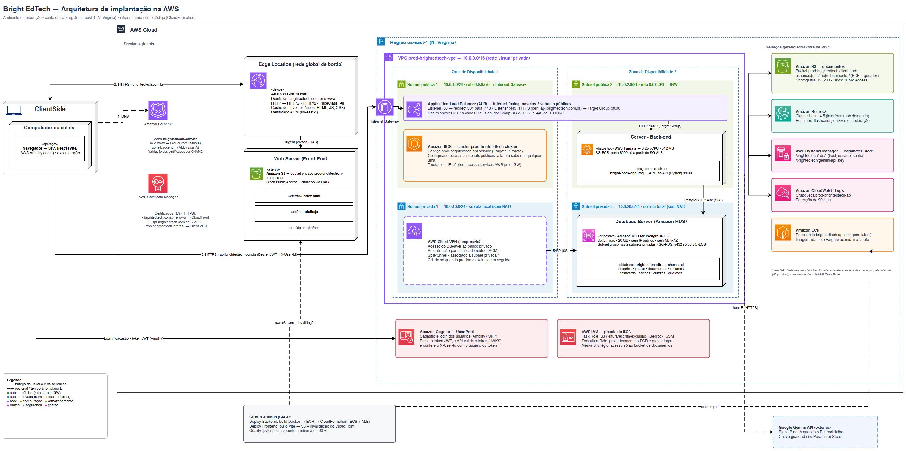
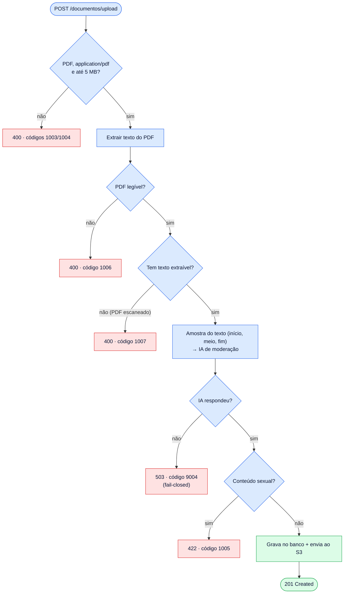
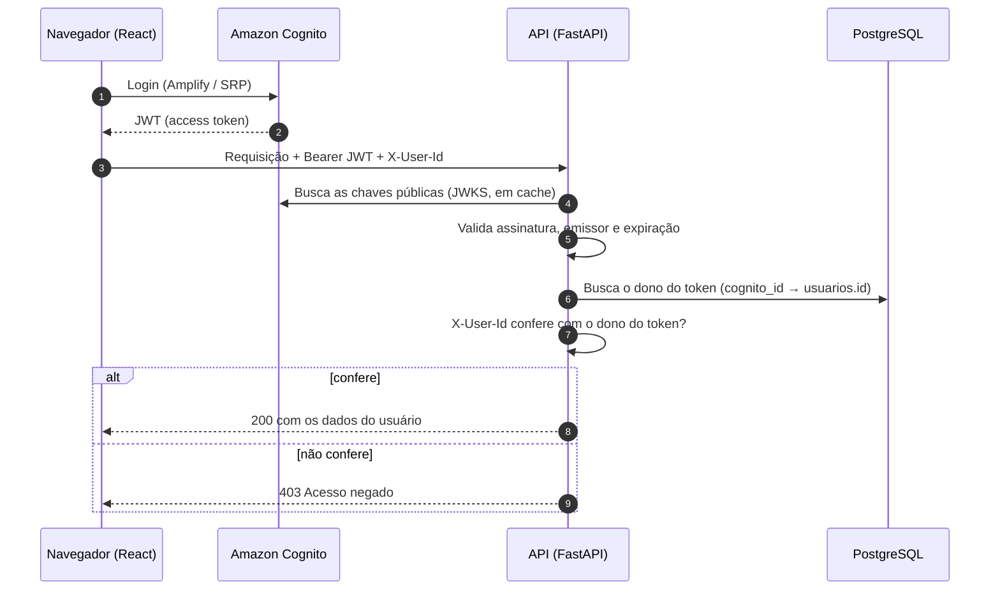
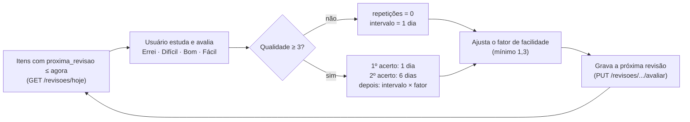
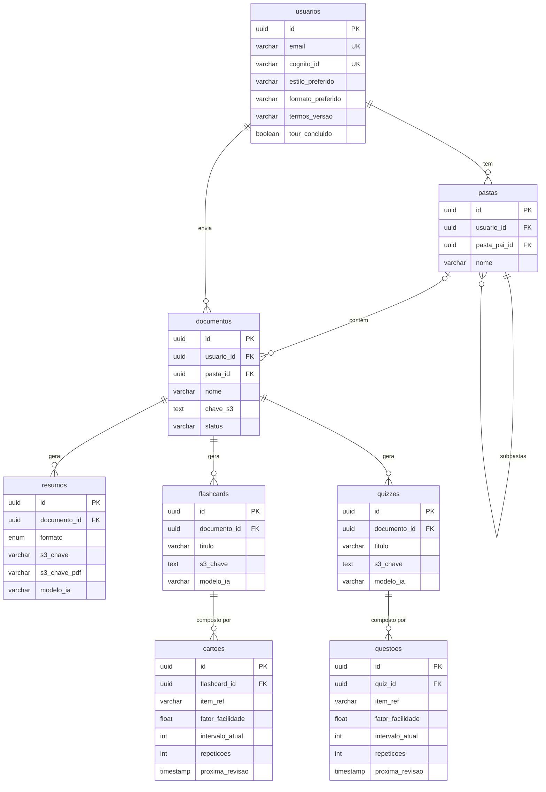

<div align="center">

# 💡 Bright EdTech — Backend

**API que transforma PDFs em resumos, flashcards e quizzes com IA — e agenda a revisão de cada item com repetição espaçada.**


-2EA44F)


[Plataforma](https://brightedtech.com.br) · [Repositório do front-end](https://github.com/joaopedro-albuquerque/bright-edtech-frontend) · [Referência da API](.context/api-reference.md)

</div>

> Projeto de conclusão do curso de **Análise e Desenvolvimento de Sistemas (IFSP)**, construído por um time de quatro estudantes.
> O ambiente de produção na AWS é ligado sob demanda (workflow de *shutdown* para controlar custo) — se a API estiver fora do ar, ela sobe em poucos minutos pelo workflow **Deploy Backend**.

---

## O problema e a proposta

Estudar com PDFs costuma ser leitura passiva: o aluno lê, acha que aprendeu e esquece em poucos dias.
A **Bright EdTech** funciona como um *copiloto de estudos*:

1. o aluno envia o material em PDF;
2. a IA gera **resumos** (3 métodos), **flashcards** e **quizzes**;
3. um algoritmo de **repetição espaçada (SM-2)** decide *quando* cada item deve ser revisado — revisar logo antes de esquecer fixa o conteúdo com menos esforço.

Este repositório é o **back-end**: regras de negócio, integração com IA, armazenamento, autenticação e a infraestrutura na AWS.

## Destaques técnicos

| | |
|---|---|
| 🧠 **IA com redundância** | Amazon Bedrock (Claude Haiku 4.5) como principal e **Gemini como plano B automático** se o Bedrock falhar. Textos longos são divididos em partes (*chunking*). |
| 🛡️ **Moderação no upload** | Antes de gravar qualquer coisa, uma amostra do texto (início, meio e fim) passa por uma IA de moderação. Política *fail-closed*: se a moderação não responde, o upload é recusado. |
| 🔁 **Repetição espaçada (SM-2)** | Cada flashcard e cada questão tem seu próprio calendário de revisão. O "Daily Mix" junta tudo que vence hoje. |
| 🔐 **Autenticação e isolamento de dados** | JWT do Amazon Cognito validado por JWKS e checagem de que o `X-User-Id` pertence ao dono do token — um usuário não acessa dados de outro. |
| 🗑️ **Exclusão completa (LGPD)** | Excluir um documento ou a conta apaga arquivos no S3 **e** linhas no banco (cascata). Se o S3 falhar, nada é apagado e dá para tentar de novo. |
| ☁️ **Infra como código** | VPC, subnets, ALB, ECS Fargate, RDS, Cognito, CloudFront e S3 descritos em CloudFormation; deploy por GitHub Actions. |
| ✅ **Qualidade** | 524 testes automatizados com **100% de cobertura de linhas e branches**, e gate de 80% no pipeline. |
| 🧾 **Observabilidade** | Logs estruturados em JSON com *request id* por requisição, enviados ao CloudWatch (retenção de 90 dias). |

---

## Arquitetura na AWS



> Código-fonte editável do diagrama: [`docs/arquitetura-aws.drawio`](docs/arquitetura-aws.drawio) (abra no [diagrams.net](https://app.diagrams.net)).

**Como o tráfego flui**

1. O navegador resolve `brightedtech.com.br` (Route 53) e baixa o front-end estático do **CloudFront**, que lê de um bucket S3 **privado** (acesso só via OAC).
2. O login é feito no **Cognito**, que devolve um JWT.
3. As chamadas à API vão para `api.brightedtech.com.br` → **ALB** (HTTPS, certificado ACM) → tarefa **Fargate** com a API FastAPI na porta 8000.
4. A API lê/grava no **RDS PostgreSQL** (subnet privada, sem IP público), guarda arquivos e artefatos gerados no **S3**, chama **Bedrock/Gemini** e envia logs ao **CloudWatch**.

**Rede e segurança**

| Camada | Configuração |
|---|---|
| VPC | `10.0.0.0/16`, duas zonas de disponibilidade |
| Subnets públicas | `10.0.1.0/24` e `10.0.2.0/24` — ALB e tarefa Fargate (rota `0.0.0.0/0` → Internet Gateway) |
| Subnets privadas | `10.0.10.0/24` e `10.0.20.0/24` — RDS (só rota local, sem NAT) |
| Security Groups | **ALB**: 80/443 de qualquer origem · **ECS**: 8000 só do SG do ALB · **RDS**: 5432 só do SG do ECS |
| Dados | S3 com criptografia SSE e *Block Public Access*; RDS sem acesso público; credenciais no SSM Parameter Store |
| Acesso administrativo | **AWS Client VPN** temporário, criado só quando necessário (conexão do DBeaver ao banco privado) |

<details>
<summary><b>Decisões de arquitetura e trade-offs</b></summary>

- **Fargate em subnet pública (por custo).** A tarefa precisa falar com ECR, S3, Bedrock, SSM, Cognito e Gemini. Em subnet privada isso exigiria um NAT Gateway (~US$ 33/mês, só para um projeto acadêmico). O risco é mitigado pelo Security Group: a porta 8000 só aceita tráfego vindo do ALB. Evolução natural para produção real: subnets privadas + NAT Gateway.
- **Uma tarefa Fargate (0,25 vCPU / 512 MB).** Dimensionado para a demonstração; o serviço ECS já suporta aumentar `DesiredCount` atrás do ALB.
- **RDS sem Multi-AZ.** Reduz custo; o *subnet group* já abrange as duas zonas, então habilitar Multi-AZ é uma alteração de configuração.
- **Ambiente liga/desliga.** O workflow `Shutdown Backend` remove ECS/ALB e para o RDS; `Deploy Backend` recria tudo. Custo próximo de zero fora das demonstrações.
- **IA com plano B.** O nome histórico da classe `BedrockService` permanece, mas ela orquestra Bedrock → Gemini (veja [`.context/ia-generativa.md`](.context/ia-generativa.md)).

</details>

---

## Fluxos principais

### 1. Upload com validação e moderação



### 2. Autenticação e isolamento por usuário



### 3. Revisão espaçada (SM-2)

Cada flashcard e cada questão guarda três números: **fator de facilidade** (começa em 2,5), **intervalo** em dias e **repetições** seguidas com acerto.



Exemplo com respostas "Bom" sempre: revisa em **1 dia → 6 dias → 15 dias → ~38 dias**; se errar, volta para 1 dia.

---

## Modelo de dados

Dados relacionais no **PostgreSQL**; o conteúdo pesado (PDFs e JSONs gerados) fica no **S3**, e o banco guarda só a chave do objeto.



> Diagrama simplificado (colunas principais). Todas as tabelas filhas também guardam `usuario_id`, e todas as chaves estrangeiras usam `ON DELETE CASCADE`, exceto `documentos.pasta_id` (`SET NULL`: apagar uma pasta não apaga os documentos). Esquema completo em [`schema.sql`](schema.sql).

**Organização no S3** — tudo do usuário sob um único prefixo, o que torna a exclusão por documento ou por conta trivial:

```
usuarios/{usuario_id}/{documento_id}/
├── original.pdf               # arquivo enviado
├── resumo-{formato}.md        # resumo em Markdown
├── resumo-{formato}.pdf       # versão em PDF
├── flashcard-{quantidade}.json
└── quiz-{quantidade}.json
```

---

## API

Documentação interativa (Swagger) em `/docs`. Referência completa com exemplos reais de requisição e resposta em [`.context/api-reference.md`](.context/api-reference.md).

| Grupo | Endpoints principais |
|---|---|
| **Perfil** | `POST /profile` · `GET /profile` · `PUT /profile/{id}` · `DELETE /profile/{id}` · `POST /profile/{id}/perfil` (onboarding) · `GET /profile/{id}/dashboard` |
| **Pastas** | `POST /pastas` · `GET /pastas/user/{id}` · `GET /pastas/{id}/conteudo` · `PUT` · `DELETE` |
| **Documentos** | `POST /documentos/upload` · `GET /documentos/{id}/url-visualizacao` · `PUT` · `DELETE` |
| **Resumos** | `POST /documentos/{id}/resumos` (Executivo, Cornell ou Fichamento) · `GET /resumos/{id}/conteudo` |
| **Flashcards** | `POST /documentos/{id}/flashcards` · `GET /flashcards/{id}/conteudo` |
| **Quizzes** | `POST /documentos/{id}/quizzes` · `GET /quizzes/{id}/conteudo` |
| **Revisão** | `GET /revisoes/hoje` (Daily Mix) · `PUT /revisoes/cartoes/{id}/avaliar` · `PUT /revisoes/questoes/{id}/avaliar` |

Erros seguem um contrato único (`error_code`, `message`, lista de violações por campo), o que permite ao front exibir mensagens específicas por código.

---

## Stack

| Área | Tecnologias |
|---|---|
| Linguagem e framework | Python 3.12, FastAPI, Uvicorn, Pydantic v2 |
| Arquitetura | Camadas `routers → services → repositories`, injeção de dependências do FastAPI, handlers globais de exceção |
| Banco | PostgreSQL 18 (Amazon RDS), `psycopg2` |
| IA | Amazon Bedrock (Claude Haiku 4.5) com *fallback* para Google Gemini |
| Documentos | `pypdf` (extração de texto), `reportlab` / `xhtml2pdf` (geração de PDF a partir do resumo) |
| Autenticação | Amazon Cognito + `PyJWT` (validação por JWKS) |
| Infra | ECS Fargate, ALB, RDS, S3, CloudFront, Route 53, ACM, ECR, SSM, CloudWatch, CloudFormation |
| CI/CD | GitHub Actions (build Docker → ECR → CloudFormation) |
| Testes | pytest, pytest-cov, pytest-mock, pytest-asyncio, Allure |

---

## Qualidade e testes

- **524 testes** (unitários e de rotas) cobrindo serviços, repositórios, middlewares, handlers de erro e schemas.
- **100% de cobertura de linhas e de branches** (2.085 statements, 194 branches).
- O workflow **Quality** roda a suíte com `--cov-fail-under=80`.
- As chamadas externas (S3, Bedrock, Gemini, banco) são isoladas por *mocks*, então a suíte roda sem credenciais.

```bash
pip install -r requirements-dev.txt
pytest                      # gera htmlcov/, report.html e allure-results/
```

---

## Como rodar localmente

**Pré-requisitos:** Python 3.12, PostgreSQL com o [`schema.sql`](schema.sql) aplicado e (para os recursos de IA/arquivos) credenciais AWS configuradas.

```bash
python -m venv venv
source venv/bin/activate            # Windows: venv\Scripts\activate
pip install -r requirements.txt

# crie um arquivo .env na raiz com as variáveis da tabela abaixo
uvicorn app.main:app --reload --port 8000
```

Abra `http://localhost:8000/docs`.

**Variáveis de ambiente principais**

| Variável | Para quê |
|---|---|
| `DB_HOST`, `DB_USER`, `DB_PASSWORD`, `DB_NAME` | Conexão com o PostgreSQL. Em produção são lidas do SSM Parameter Store; localmente caem para o `.env` |
| `S3_BUCKET_NAME` | Bucket de documentos e artefatos |
| `AWS_REGION` | Região (`us-east-1`) |
| `BEDROCK_MODEL_SUMMARY`, `BEDROCK_MODEL_EXTRACT` | Modelos do Bedrock |
| `GEMINI_API_KEY`, `GEMINI_MODEL_FALLBACK` | Plano B de IA |
| `COGNITO_USER_POOL_ID`, `COGNITO_CLIENT_ID`, `COGNITO_REGION` | Validação do JWT |
| `REQUIRE_AUTH` | `false` desliga a autenticação (apenas para desenvolvimento local) |

> O CORS libera `http://localhost:5173`, a porta padrão do front-end em desenvolvimento.

**Com Docker**

```bash
docker build -t bright-edtech-backend .
docker run -p 8000:8000 --env-file .env bright-edtech-backend
```

---

## Deploy

A infraestrutura é dividida em *stacks* CloudFormation independentes, em [`cloudformation/`](cloudformation):

| Stack | Conteúdo | Custo |
|---|---|---|
| `base-network-security` | VPC, subnets, Security Groups, IAM, bucket de documentos | ~zero (persistente) |
| `database` | RDS PostgreSQL (com *snapshot* ao excluir) | instância + disco |
| `cognito` | User Pool e client da aplicação | gratuito no volume do projeto |
| `compute` | ALB, ECS Fargate, registros Route 53, log group | cobrado por hora |
| `s3-front-cloudfront` | Bucket privado do front-end | centavos |

**Workflows do GitHub Actions** (todos manuais, `workflow_dispatch`):

| Workflow | O que faz |
|---|---|
| **Deploy Backend** | Liga o RDS (se parado), constrói a imagem Docker, envia ao ECR, aplica a stack de computação e roda *smoke test* |
| **Shutdown Backend** | Exclui a stack de computação (ECS + ALB) e para o RDS, zerando o custo por hora |
| **Quality** | Executa os testes com gate de cobertura |

---

## Estrutura do projeto

```
app/
├── api/
│   ├── routers/          # rotas HTTP (profile, document, revisao)
│   ├── middlewares/      # request id
│   └── dependencies.py   # injeção de dependências e checagem do X-User-Id
├── core/                 # config, banco, auth (JWT), exceções, logging
├── services/             # regras de negócio (IA, S3, SM-2, geração de PDF...)
├── repositories/         # acesso ao PostgreSQL
├── schemas/              # modelos Pydantic de entrada e saída
└── main.py
cloudformation/           # infraestrutura como código
docs/                     # diagrama de arquitetura
tests/                    # suíte pytest espelhando app/
schema.sql                # esquema do banco
.context/                 # documentação técnica detalhada
```

## Documentação adicional

- [Visão geral do produto](.context/visao-geral.md) · [Arquitetura](.context/arquitetura.md) · [Dados](.context/dados.md)
- [Referência da API](.context/api-reference.md) · [Modelos de resumo](.context/modelos-resumo.md)
- [IA generativa: Bedrock e Gemini](.context/ia-generativa.md) · [Plano de testes](.context/plano-de-testes-v2.md)

## Time

Projeto desenvolvido por **Eric, João, Miguel e Gabriela**, estudantes de Análise e Desenvolvimento de Sistemas no IFSP.

> ⚠️ Conteúdos gerados por inteligência artificial podem conter imprecisões. Confira sempre com o material original antes de usá-los como única fonte de estudo.
