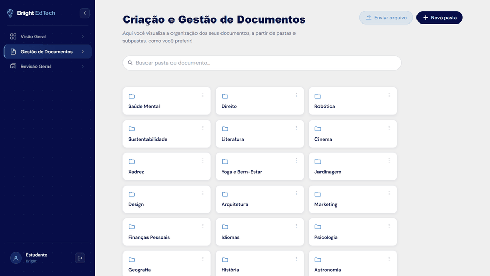
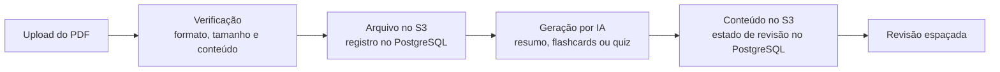
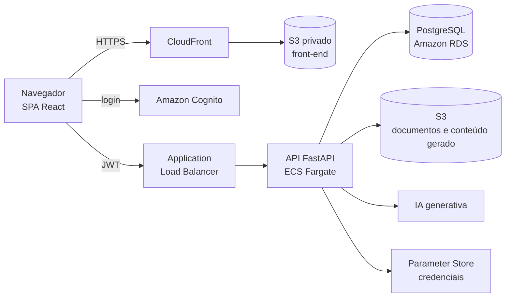
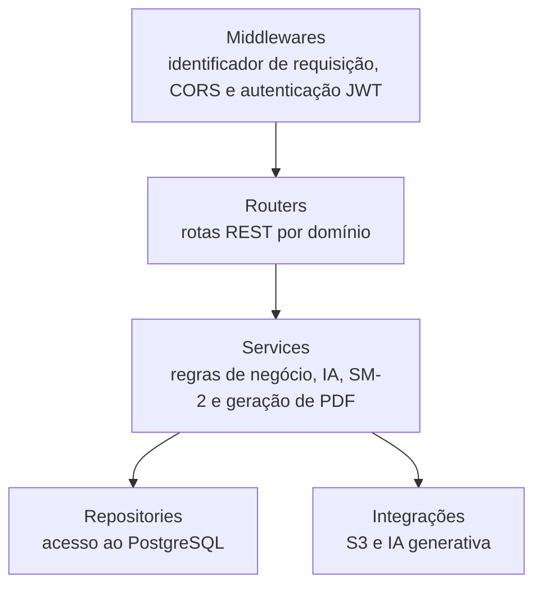
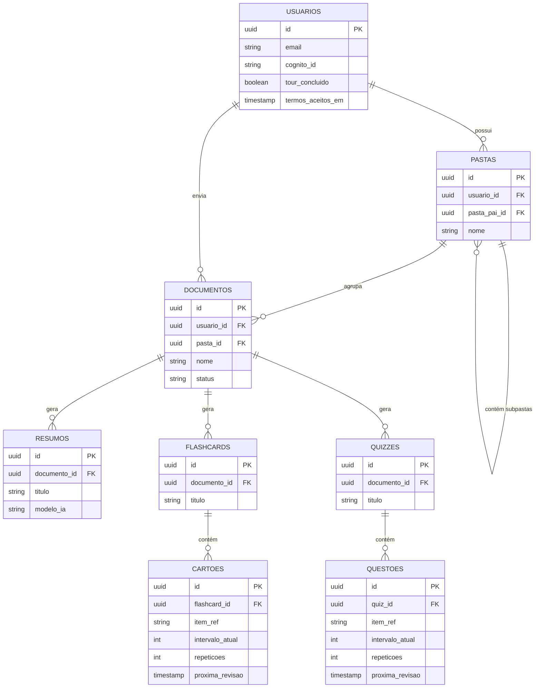
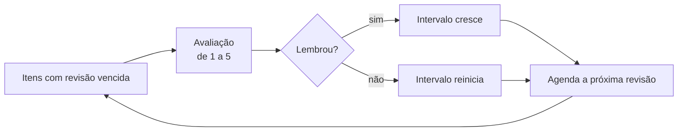

<div align="center">

# Bright EdTech API

**API que sustenta a plataforma de estudo: organização de PDFs, geração de material com IA e agendamento de revisões.**


[Acessar a plataforma](https://brightedtech.com.br) · [Repositório do front-end](https://github.com/joaopedro-albuquerque/bright-edtech-frontend) · [Referência da API](.context/api-reference.md)



</div>

## Índice

- [Sobre](#sobre)
- [O que a API oferece](#o-que-a-api-oferece)
- [Como funciona](#como-funciona)
- [Arquitetura](#arquitetura)
- [Modelagem de dados](#modelagem-de-dados)
- [Revisão espaçada](#revisão-espaçada)
- [Endpoints](#endpoints)
- [Segurança](#segurança)
- [Tecnologias](#tecnologias)
- [Qualidade](#qualidade)
- [Estrutura do projeto](#estrutura-do-projeto)
- [Executando localmente](#executando-localmente)
- [Documentação técnica](#documentação-técnica)

## Sobre

A Bright EdTech é uma plataforma para quem estuda a partir de documentos. O estudante envia um PDF e recebe resumos, flashcards e quizzes do próprio material, com as revisões agendadas por repetição espaçada.

Este repositório contém o **back-end**: as rotas HTTP, as regras de negócio, a integração com IA e a infraestrutura como código. A interface está no [repositório do front-end](https://github.com/joaopedro-albuquerque/bright-edtech-frontend).

## O que a API oferece

| Recurso | Descrição |
|---|---|
| Documentos | Envio de PDFs com verificação de formato, tamanho e conteúdo; organização em pastas e subpastas; busca por nome; visualização do arquivo |
| Resumos | Três formatos: Executivo, Cornell e Fichamento acadêmico, com download em PDF |
| Flashcards e quizzes | Geração a partir do documento, com quantidade e dificuldade configuráveis |
| Revisão espaçada | Agenda cada item pelo algoritmo SM-2 e lista o que está atrasado, agrupado por documento |
| Perfil e conta | Cadastro, onboarding, aceite dos termos e exclusão completa da conta |

## Como funciona



O banco de dados guarda os metadados e o estado de revisão de cada item. O conteúdo textual dos materiais gerados fica no S3 e é combinado com o estado de revisão na hora de responder, por meio de um identificador de item (`item_ref`).

## Arquitetura

O back-end é uma aplicação FastAPI executada em contêiner no Amazon ECS (Fargate), atrás de um Application Load Balancer. O front-end é estático, servido por CloudFront a partir de um bucket S3 privado.



A aplicação segue uma arquitetura em camadas:



A infraestrutura é descrita em CloudFormation (`cloudformation/`) e implantada por workflows manuais do GitHub Actions.

## Modelagem de dados



Todas as tabelas de conteúdo também referenciam `usuario_id`, o que permite filtrar cada consulta pelo dono do recurso. O esquema completo está em [`schema.sql`](schema.sql).

## Revisão espaçada

Cada cartão e cada questão guarda o fator de facilidade, o intervalo atual, o número de repetições e a data da próxima revisão. O algoritmo SM-2 recalcula esses valores a cada avaliação.



## Endpoints

A documentação interativa (Swagger) fica em `/docs`. A referência completa, com exemplos, está em [`.context/api-reference.md`](.context/api-reference.md).

| Grupo | Exemplos |
|---|---|
| Perfil | `POST /profile`, `GET /profile`, `PUT /profile/{id}`, `DELETE /profile/{id}` |
| Pastas | `POST /pastas`, `GET /pastas/user/{id}`, `GET /pastas/{id}/conteudo` |
| Documentos | `POST /documentos/upload`, `GET /documentos`, `GET /documentos/{id}/url-visualizacao` |
| Resumos | `POST /documentos/{id}/resumos`, `GET /resumos/{id}/conteudo`, `GET /resumos/{id}/pdf` |
| Flashcards | `POST /documentos/{id}/flashcards`, `GET /flashcards/{id}/conteudo` |
| Quizzes | `POST /documentos/{id}/quizzes`, `GET /quizzes/{id}/conteudo` |
| Revisões | `GET /revisoes/hoje`, `GET /revisoes/lotes`, `PUT /revisoes/cartoes/{id}/avaliar` |

## Segurança

- **Autenticação:** cadastro e login pelo Amazon Cognito; o token JWT é validado em todas as rotas.
- **Isolamento por usuário:** toda consulta é filtrada pelo dono do recurso, e o identificador informado na requisição é conferido com o do token.
- **Verificação do conteúdo enviado:** o arquivo é validado e analisado antes de ser aceito.
- **Dados:** arquivos em bucket privado com criptografia, banco em sub-rede privada sem endereço público e credenciais no Parameter Store.
- **Exclusão de conta:** remove os dados do banco e os arquivos armazenados.

## Tecnologias

| Área | Tecnologias |
|---|---|
| Linguagem e framework | Python 3.12, FastAPI, Pydantic v2 |
| Banco de dados | PostgreSQL (Amazon RDS) |
| IA generativa | Modelos de linguagem via serviço gerenciado |
| Autenticação | Amazon Cognito |
| Infraestrutura | ECS Fargate, RDS, S3, CloudFront, CloudFormation |
| CI/CD | GitHub Actions |
| Testes | pytest, pytest-cov, pytest-mock |

## Qualidade

A suíte tem 592 testes automatizados, com 100% de cobertura de linhas e de ramos. As dependências externas (banco, S3 e IA) são simuladas, então os testes rodam sem credenciais.

```bash
pip install -r requirements-dev.txt
pytest
```

## Estrutura do projeto

```
app/
├── api/           # rotas HTTP e middlewares
├── core/          # configuração, banco, autenticação e exceções
├── services/      # regras de negócio, IA, S3, SM-2 e geração de PDF
├── repositories/  # acesso ao PostgreSQL
├── schemas/       # modelos de entrada e saída
└── main.py
cloudformation/    # infraestrutura como código
tests/             # testes automatizados
schema.sql         # esquema do banco
.context/          # documentação técnica
```

## Executando localmente

Requisitos: Python 3.12 e PostgreSQL com o [`schema.sql`](schema.sql) aplicado.

```bash
python -m venv venv
source venv/bin/activate            # Windows: venv\Scripts\activate
pip install -r requirements.txt

# crie um .env na raiz com as credenciais do banco, do S3 e da IA
uvicorn app.main:app --reload --port 8000
```

A documentação interativa fica em `http://localhost:8000/docs`.

## Documentação técnica

- [Visão geral do produto](.context/visao-geral.md)
- [Arquitetura](.context/arquitetura.md)
- [Modelo de dados](.context/dados.md)
- [Referência da API](.context/api-reference.md)

---

<sub>Projeto acadêmico do curso de Análise e Desenvolvimento de Sistemas do Instituto Federal de São Paulo (IFSP). Conteúdos gerados por inteligência artificial podem conter imprecisões e devem ser conferidos com o material original.</sub>
