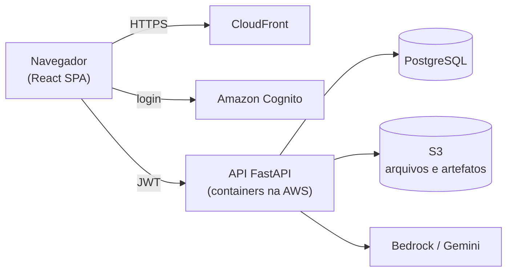
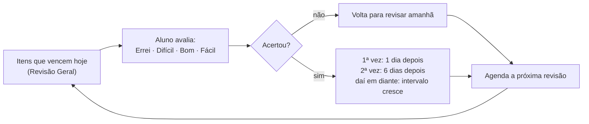

<div align="center">

# 💡 Bright EdTech — Backend

**Transforme qualquer PDF em resumo, flashcards e quiz com IA — e nunca mais esqueça o que estudou.**


[Plataforma](https://brightedtech.com.br) · [Repositório do front-end](https://github.com/joaopedro-albuquerque/bright-edtech-frontend) · [Referência da API](.context/api-reference.md)

</div>

> TCC do curso de **Análise e Desenvolvimento de Sistemas (IFSP)**, construído por um time de quatro estudantes.
> O ambiente de produção é ligado sob demanda para economizar — se a plataforma estiver fora do ar no momento, ela volta em poucos minutos.

---

## O problema

Estudar com PDF costuma ser leitura passiva: o aluno lê, acha que aprendeu e esquece em poucos dias. Grifar e reler não resolve, e organizar manualmente quando revisar cada assunto toma um tempo que ninguém tem sobrando.

## A solução

A **Bright EdTech** funciona como um copiloto de estudos:

1. o aluno envia um PDF;
2. a IA transforma o conteúdo em **resumos** (3 formatos diferentes), **flashcards** e **quizzes**;
3. um algoritmo de **repetição espaçada (SM-2)** decide *quando* cada item deve ser revisado — revisar pouco antes de esquecer fixa o conteúdo com muito menos esforço.

Este repositório é o **back-end**: a API, as regras de negócio, a integração com IA e a infraestrutura que sustentam a plataforma.

## Por que vale a pena olhar este projeto

- 🧠 **IA com plano B** — Amazon Bedrock como principal e Google Gemini assume automaticamente se o primeiro falhar, sem o usuário perceber.
- 🛡️ **Moderação de conteúdo** — todo upload passa por uma checagem de IA antes de ser aceito na plataforma.
- 🔁 **Repetição espaçada de verdade** — algoritmo SM-2 implementado e coberto por testes dedicados, não um cronograma fixo.
- 🔐 **Autenticação e isolamento de dados** — login via Amazon Cognito, com garantia de que um usuário nunca acessa dados de outro.
- 🗑️ **Exclusão completa (LGPD)** — apagar a conta remove tudo, banco de dados e arquivos armazenados.
- ☁️ **Infraestrutura como código** — toda a nuvem provisionada via CloudFormation, com deploy automatizado.
- ✅ **Qualidade levada a sério** — 524 testes automatizados, 100% de cobertura de linhas e branches.

## Como funciona



O front-end é servido como site estático via CloudFront; a API roda em containers na AWS, autenticada via Cognito, com dados em PostgreSQL e arquivos no S3. Toda a infraestrutura é descrita como código e implantada por CI/CD — detalhes em [`.context/arquitetura.md`](.context/arquitetura.md).

## O cérebro do produto: repetição espaçada

Cada flashcard e cada questão tem seu próprio calendário de revisão, baseado em três números: fator de facilidade, intervalo e sequência de acertos.



Exemplo prático: respondendo "Bom" sempre, o conteúdo reaparece em **1 dia → 6 dias → 15 dias → ~38 dias**. Errar reinicia o ciclo sem punir o aluno — ele só revisa de novo mais cedo.

---

## Stack

| Área | Tecnologias |
|---|---|
| Linguagem e framework | Python 3.12, FastAPI, Pydantic v2 |
| Banco de dados | PostgreSQL (Amazon RDS) |
| IA | Amazon Bedrock (Claude) com *fallback* para Google Gemini |
| Autenticação | Amazon Cognito |
| Infraestrutura | ECS Fargate, RDS, S3, CloudFront, CloudFormation |
| CI/CD | GitHub Actions |
| Testes | pytest, pytest-cov, pytest-mock |

## Testes e qualidade

524 testes automatizados cobrindo regras de negócio, rotas e tratamento de erros, com **100% de cobertura de linhas e branches**. As dependências externas (banco, S3, IA) são simuladas, então a suíte roda sem precisar de nenhuma credencial:

```bash
pip install -r requirements-dev.txt
pytest
```

## Rodando localmente

**Pré-requisitos:** Python 3.12 e PostgreSQL com o [`schema.sql`](schema.sql) aplicado.

```bash
python -m venv venv
source venv/bin/activate            # Windows: venv\Scripts\activate
pip install -r requirements.txt

# crie um .env na raiz com as credenciais do banco, S3 e IA
uvicorn app.main:app --reload --port 8000
```

Abra `http://localhost:8000/docs` para a documentação interativa (Swagger).

## Quer ir mais fundo?

A documentação técnica completa — arquitetura, modelo de dados, referência da API e decisões de projeto — está em [`.context/`](.context):

- [Visão geral do produto](.context/visao-geral.md)
- [Arquitetura](.context/arquitetura.md)
- [Modelo de dados](.context/dados.md)
- [Referência da API](.context/api-reference.md)
- [IA generativa: Bedrock e Gemini](.context/ia-generativa.md)

## Estrutura do projeto

```
app/
├── api/           # rotas HTTP e middlewares
├── core/          # config, banco, autenticação, exceções
├── services/      # regras de negócio (IA, S3, SM-2, geração de PDF...)
├── repositories/  # acesso ao PostgreSQL
├── schemas/       # modelos de entrada e saída
└── main.py
cloudformation/    # infraestrutura como código
tests/             # suíte de testes automatizados
schema.sql         # esquema do banco
.context/          # documentação técnica detalhada
```

## Time

Projeto desenvolvido por **Eric, João, Miguel e Gabriela**, estudantes de Análise e Desenvolvimento de Sistemas no IFSP.

> ⚠️ Conteúdos gerados por inteligência artificial podem conter imprecisões. Confira sempre com o material original antes de usá-los como única fonte de estudo.
